# FOAI W02｜补课阅读笔记（图解版）

> [!IMPORTANT]
> **非官方学习笔记**：这是我在 University of Bristol「Foundations of Artificial Intelligence（SEMTM0051, 2026/27）」课程中的个人中文翻译与学习笔记，**不是官方课程材料**，可能有错漏，以官方原文为准。
> 原课程材料作者：Conor Houghton、Roberto Colomboni。原始材料：[semtm0051/2026_27](https://github.com/semtm0051/2026_27/tree/322787dec91f174303ccf90399bb6243a060eb7d/)。经两位讲师同意公开；不含练习解答与非公开材料（如课堂录像）。

> [!NOTE]
> **资料范围与可靠度：high（一手）**
> 内容来自官方讲义、官方 Slides 和 Lab notebook。图中所有数字都用 Python 复算过，与 Slides 一致（SSE 46 / 26 / 6 / 2.5，梯度下降 66 → 14.8 → 8.656 …）。

> [!TIP]
> **怎么读（基础薄弱版）**
> - 第 0 节先过一遍，是后面所有公式要用的"工具箱"。看不懂的符号回来查。
> - 带 ✏️ 的是**手算**，拿纸笔跟着算一遍，比看十遍有用。
> - 全文约 60–90 分钟。读完做第 9 节自测，答得出就够去上 Week 3。

---

## 0. 先备知识工具箱（5 个，后面全靠它们）

### 0.1 求和符号 $\sum$

$\sum_{i=1}^{N} a_i$ 就是 $a_1 + a_2 + \dots + a_N$。$i$ 是"第几个"，$N$ 是总个数。

- 例：$x = (-2,-1,0,1,2)$，则 $\sum_i x_i = -2-1+0+1+2 = 0$，$\sum_i x_i^2 = 4+1+0+1+4 = 10$。
- 注意区分：$\sum x_i^2$ 是"先平方再加"；$(\sum x_i)^2$ 是"先加再平方"。上面两个分别是 10 和 0。

### 0.2 均值 $\bar y$

$\bar y = \frac1N\sum_i y_i$，就是平均数。读作"y bar"。

### 0.3 导数（derivative）= 切线斜率

函数 $L(b)$ 的导数 $L'(b)$ 告诉你：**在 $b$ 这一点，$b$ 增加一点点，$L$ 会增加还是减少、变化多快。**

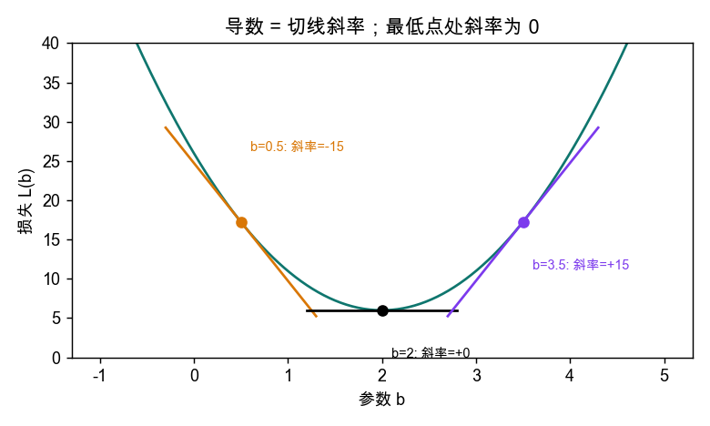

*图 1：一条示意抛物线（不是本讲数据，只为说明导数）。左边斜率为负（往右走损失在降），右边斜率为正（往右走损失在升），最低点斜率恰好为 0。*

这给出整讲的第一个核心思路：

> **想找函数的最低点 → 找导数等于 0 的点。**（讲义叫 Fermat 引理；导数为 0 的点叫**驻点 stationary point**。）

你需要会的求导规则只有三条：

| 规则 | 例子 |
|---|---|
| $(r^2)' = 2r$ | $(b^2)' = 2b$ |
| 常数求导为 0；求谁的导，别的变量当常数 | $\frac{d}{db}(b - y_i) = 1$（$y_i$ 是已知数据，是常数） |
| **链式法则**：$\frac{d}{db} [r(b)]^2 = 2\,r(b)\cdot r'(b)$ | $r(b)=b-y_i$ ⇒ $2(b-y_i)\cdot 1$ |

**偏导数（partial derivative）**：函数有两个参数，如 $L(b,a)$ 时，对 $b$ 求导就把 $a$ 当常数，记作 $\frac{\partial L}{\partial b}$；对 $a$ 同理。**梯度（gradient）** $\nabla L$ 就是把所有偏导排成一列：$\nabla L = \begin{pmatrix}\partial L/\partial b\\ \partial L/\partial a\end{pmatrix}$。复习见 [FOAI-W01-数学预备](FOAI-公开版-W01-数学预备.md)。

### 0.4 向量与矩阵的最小集合

- **向量**：一列数，如 $\theta = \begin{pmatrix} b\\ a\end{pmatrix}$（2×1，即 2 行 1 列）。
- **矩阵**：数字表格，形状写作 行×列。$N\times 2$ 表示 $N$ 行 2 列。
- **转置** $X^\top$：行列互换。$N\times 2$ 变成 $2\times N$。
- **矩阵乘法**：$(m\times n)\cdot(n\times p) = (m\times p)$——**中间的 $n$ 必须相等**，且会被"消掉"。这条是检查形状对不对的万能方法。
- **逆矩阵** $A^{-1}$：满足 $A^{-1}A = I$（单位矩阵）。只有方阵、且"满秩"时才有。
- **范数平方** $\|v\|_2^2 = v_1^2 + v_2^2 + \dots$：向量各分量平方和。

### 0.5 本讲统一的符号

| 符号 | 含义 |
|---|---|
| $(x_i, y_i)$ | 第 $i$ 个观测：输入 $x_i$，目标（真实答案）$y_i$ |
| $N$ | 观测总数 |
| $\hat y$ | 模型的预测值（"y hat"） |
| $\theta$ | 参数的合称。直线里 $\theta=(b,a)$ |
| $b$ / $a$ | 截距 intercept（也叫 bias）/ 斜率 slope |
| $f_\theta(x)$ | 参数为 $\theta$ 的预测函数，如 $b + ax$ |
| $r_i = f_\theta(x_i) - y_i$ | **残差 residual = 预测 − 目标**（全课统一，别写反） |
| $\ell$ / $\mathcal L$ | 单条损失 / 全数据集总损失 |
| $\eta$ | 学习率（learning rate），梯度下降的步长 |

---

## 1. 本讲要解决什么问题（一图看全）

**回归（regression）**：根据输入 $x$ 预测一个**连续的数值** $y$（房价、温度……），区别于预测类别的分类（Week 3 的内容）。

设定：我们看到 $N$ 个点 $(x_i,y_i)$，相信它们来自
$$y_i = f_{\text{true}}(x_i) + \varepsilon_i,$$
$f_{\text{true}}$ 是**未知的**真实规律，$\varepsilon_i$ 是**未知的**噪声（测量误差等）。我们只能从点出发，**猜**一个 $f$。

整讲其实就是一个三步套路。**后面所有模型（包括神经网络）都套这个模板**：

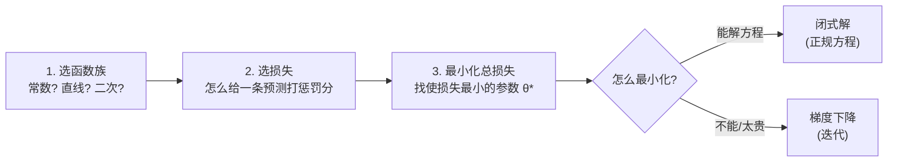

本讲的"剧情线"：

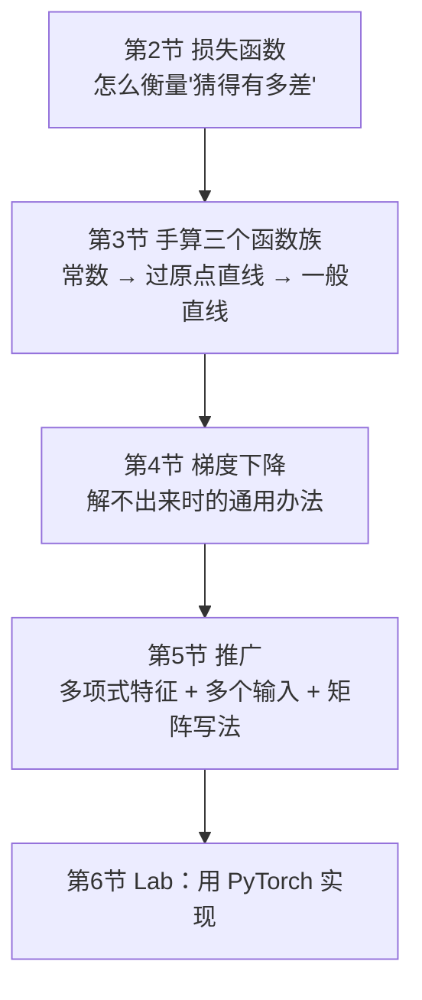

**贯穿全讲的同一组数据**（5 个点，务必记住，后面反复用）：

| $i$ | 1 | 2 | 3 | 4 | 5 |
|---|---|---|---|---|---|
| $x_i$ | −2 | −1 | 0 | 1 | 2 |
| $y_i$ | −1.5 | 0.5 | 1 | 2.5 | 7.5 |

---

## 2. 怎么衡量"猜得好不好"：损失函数

### 2.1 残差

给一条候选直线，每个点上"预测"和"目标"之间有差距：
$$r_i = f(x_i) - y_i \quad(\text{预测} - \text{目标}).$$
$r_i>0$：高估；$r_i<0$：低估。

### 2.2 两种单点损失

$$\ell_{\text{abs}}(\hat y, y) = |\hat y - y|, \qquad \ell_{\text{sq}}(\hat y, y) = (\hat y - y)^2.$$

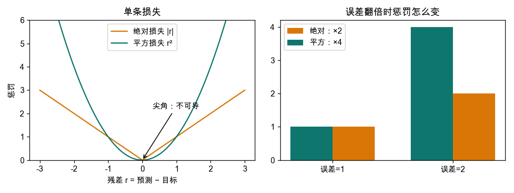

*图 2：左：两种损失随残差的形状。右：误差从 1 变 2，绝对损失 ×2，平方损失 ×4。*

要点（Slides P.7）：
1. 平方损失对**大误差更狠**（误差翻倍，惩罚×4），所以一个离群点会把拟合线"拽"过去很多。
2. 平方损失是一条光滑曲线，**处处可求导**；绝对损失在 $r=0$ 处有尖角，**不可导**。我们要靠"导数=0"找最低点，所以本讲主用平方损失。
3. 损失选什么，应该反映应用目标（Slides P.9）。没有绝对的"最好的损失"。

### 2.3 总损失（经验损失 empirical loss）

把所有数据点的损失加起来：
$$\mathcal L_{\text{sq}}(\theta) = \sum_{i=1}^N \big(f_\theta(x_i) - y_i\big)^2 \quad(\text{也叫 SSE，误差平方和}).$$

> [!IMPORTANT]
> **谁是常数，谁在变**
> 拟合时 $(x_i,y_i)$ **固定不变**，唯一在变的是参数 $\theta$。所以 $\mathcal L$ 是 **$\theta$ 的函数**。"训练"= 在 $\theta$ 的空间里找让 $\mathcal L$ 最小的点。

> [!NOTE]
> **乘不乘 $\frac1N$ 或 $\frac12$ 都行**
> $\frac1N\mathcal L$、$\frac12\mathcal L$ 的**最优点和 $\mathcal L$ 完全相同**，只是梯度差一个常数倍。后面你会在不同地方看到不同版本，别慌。

### 2.4 ✏️ 手算：比较三条候选直线（Slides P.10）

候选：$f(x)=1+2x$，$g(x)=1-x$，$h(x)=2$。

| $x_i$ | −2 | −1 | 0 | 1 | 2 | SSE |
|---|---|---|---|---|---|---|
| $y_i$ | −1.5 | 0.5 | 1 | 2.5 | 7.5 | |
| $f$ 的残差 | −1.5 | −1.5 | 0 | 0.5 | −2.5 | $2.25+2.25+0+0.25+6.25=\mathbf{11}$ |
| $g$ 的残差 | 4.5 | 1.5 | 0 | −2.5 | −8.5 | $\mathbf{101}$ |
| $h$ 的残差 | 3.5 | 1.5 | 1 | −0.5 | −5.5 | $\mathbf{46}$ |

以 $f$ 的第一个点为例：$f(-2)=1+2(-2)=-3$，残差 $=-3-(-1.5)=-1.5$。✓

> [!WARNING]
> **这个比较的局限**
> $f$ 在这三条里最好，**不代表**它是所有直线里最好的。我们不想猜候选，想直接**算出**最优那条。下一节就做这件事。

---

## 3. 手算最优解：三个越来越灵活的函数族

先用图直观感受"越灵活，拟合越好"：

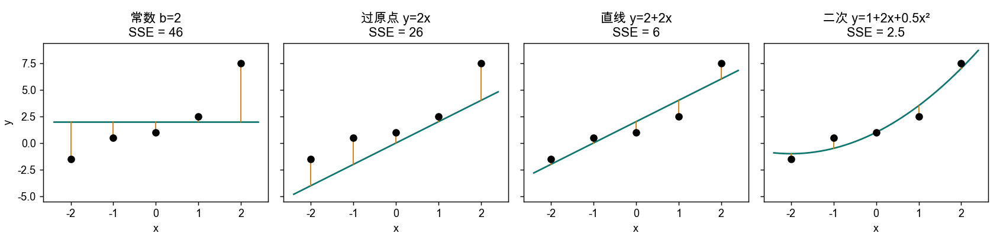

*图 3：同一组数据上，四种函数族各自的最优拟合。橙色竖线是残差。从左到右 SSE：46 → 26 → 6 → 2.5。*

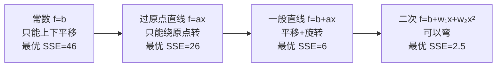

> [!WARNING]
> **别被 SSE 越来越小骗了**
> 这只是在**已有的训练数据**上更好。越灵活的模型越容易把噪声也"背"下来（**过拟合**），在没见过的新数据上未必准。本讲只管"拟合"，泛化问题后面才讲。

三个族用的是**同一个套路**，记住它：

### 3.1 最简单：常数预测 $f(x)=b$

不管 $x$ 是多少，一律预测 $b$。

**写损失：** $\mathcal L(b)=\sum_i (b-y_i)^2$。

**求导（链式法则）：** 令 $r_i(b)=b-y_i$，则 $r_i'(b)=1$（$y_i$ 是常数）。
$$\mathcal L'(b)=\sum_i 2\,r_i\cdot r_i' = 2\sum_i (b-y_i) = 2\Big(Nb-\sum_i y_i\Big).$$
（$\sum_i b = Nb$，因为把 $b$ 加 $N$ 次。）

**令导数为 0：** $Nb=\sum_i y_i \Rightarrow$
$$\boxed{b^*=\frac1N\sum_i y_i=\bar y.}$$

**结论：平方损失下，最佳常数就是平均数。**

**为什么这是全局最小，而不是最大或半山腰？** 展开 $\mathcal L(b)=Nb^2-2b\sum y_i+\sum y_i^2$，这是 $b$ 的二次函数，$b^2$ 前系数 $N>0$，**开口向上**的抛物线只有一个驻点，它就是最低点。

✏️ **代数据：** $b^*=\frac{-1.5+0.5+1+2.5+7.5}{5}=\frac{10}{5}=2$。SSE $=3.5^2+1.5^2+1^2+0.5^2+5.5^2=12.25+2.25+1+0.25+30.25=46$。

#### 小实验：换成绝对损失，最优常数是什么？（Slides P.15 / 讲义 Ex 5）

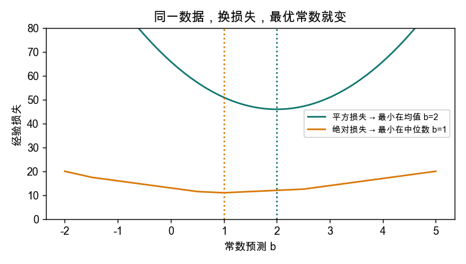

*图 4：同一组数据，两种损失下最优常数不同。平方损失最低点在均值 2；绝对损失最低点在中位数 1。*

把 $y$ 排序：$-1.5, 0.5, \mathbf{1}, 2.5, 7.5$，中位数 = 1。

> [!IMPORTANT]
> **一句话记住**
> **"最佳"取决于你选的损失：平方损失 → 均值，绝对损失 → 中位数。** 均值会被离群值（这里的 7.5）拽走，中位数不会。

### 3.2 过原点的直线 $f(x)=ax$

只有斜率 $a$ 可调，线必须穿过原点 $(0,0)$。

**损失：** $\mathcal L(a)=\sum_i (ax_i-y_i)^2$。

**求导：** $r_i(a)=ax_i-y_i$，$r_i'(a)=x_i$（对 $a$ 求导，$a$ 前面的系数 $x_i$ 留下）。
$$\mathcal L'(a)=\sum_i 2(ax_i-y_i)x_i = 2\Big(a\sum_i x_i^2-\sum_i x_i y_i\Big).$$

**令为 0：**
$$\boxed{a^*=\frac{\sum_i x_iy_i}{\sum_i x_i^2}}\quad(\text{要求 }\sum x_i^2>0).$$
如果所有 $x_i=0$，$a$ 取什么预测都一样，没有唯一最优解，所以要这个条件。

✏️ **代数据：** $\sum x_i^2=10$；$\sum x_iy_i=(-2)(-1.5)+(-1)(0.5)+0+1\cdot2.5+2\cdot7.5=3-0.5+0+2.5+15=20$。
$a^*=20/10=2$，直线 $y=2x$，SSE = 26。

### 3.3 一般直线 $f(x)=b+ax$（最小二乘 least squares）

这是本讲的主菜。两个参数都自由，$\mathcal L(b,a)=\sum_i(b+ax_i-y_i)^2$ 是**二元函数**，要对 $b$ 和 $a$ **分别**求偏导，并**同时**令为 0。

残差 $r_i=b+ax_i-y_i$。注意：
- 对 $b$ 求导：$\partial r_i/\partial b = 1$；
- 对 $a$ 求导：$\partial r_i/\partial a = x_i$。

（因为 $r_i$ 中 $b$ 的系数是 1，$a$ 的系数是 $x_i$。）于是
$$\frac{\partial\mathcal L}{\partial b}=2\sum_i r_i,\qquad \frac{\partial\mathcal L}{\partial a}=2\sum_i x_i r_i.$$

令它们为 0，得到两个关于 $(b,a)$ 的**线性方程**（**驻点方程**）：
$$\begin{cases}Nb+a\sum x_i=\sum y_i\\ b\sum x_i+a\sum x_i^2=\sum x_iy_i\end{cases}$$

**解方程（Slides P.24–27）：** 第一式除以 $N$：$b+a\bar x=\bar y$，得 $b=\bar y-a\bar x$。代回第二式整理：
$$\boxed{a^*=\frac{\sum_i(x_i-\bar x)(y_i-\bar y)}{\sum_i(x_i-\bar x)^2},\qquad b^*=\bar y-a^*\bar x.}$$

直觉：
- 分子是 $x$ 与 $y$ 的**协方差**（一起涨一起跌 → 正），分母是 $x$ 的**方差**。
- 由 $b^*=\bar y-a^*\bar x$ 得 $f(\bar x)=\bar y$：**最优直线一定穿过"重心" $(\bar x,\bar y)$**。

✏️ **代数据：** $\bar x=0$，$\bar y=2$。$\sum(x_i-\bar x)(y_i-\bar y)=\sum x_i(y_i-2)=\sum x_iy_i-2\sum x_i=20-0=20$；$\sum(x_i-\bar x)^2=10$。
$a^*=2$，$b^*=2-2\cdot0=2$。直线 $y=2+2x$，SSE = 6。

**证明这是全局最小（Slides P.28–29，值得懂一次）：**
驻点处残差记为 $r_i^*$，驻点方程恰好说明
$$\sum_i r_i^*=0,\qquad \sum_i x_ir_i^*=0.$$
任取另一组参数 $(b^*+u,\ a^*+v)$，它的残差是 $r_i^*+u+vx_i$。展开平方并求和：
$$\mathcal L(b^*+u,a^*+v)=\mathcal L(b^*,a^*)+2u\underbrace{\textstyle\sum r_i^*}_{=0}+2v\underbrace{\textstyle\sum x_ir_i^*}_{=0}+\underbrace{\textstyle\sum(u+vx_i)^2}_{\ge0}\ \ge\ \mathcal L(b^*,a^*).$$
交叉项因为驻点条件全消失，剩下平方和，不可能为负。所以任何别的参数都不会更好。

### 3.4 小结表

| 函数族 | 参数 | 最优解 | 数据上的值 | SSE |
|---|---|---|---|---|
| 常数 | $b$ | $\bar y$ | $b=2$ | 46 |
| 过原点直线 | $a$ | $\sum xy/\sum x^2$ | $a=2$ | 26 |
| 一般直线 | $b,a$ | 见上 | $b=2,a=2$ | 6 |

---

## 4. 梯度下降：解不出来时怎么办

### 4.1 为什么需要它

直线能一步解出来，是因为导数方程恰好是线性的。**复杂模型（如神经网络）没有闭式解（closed-form solution，能直接写成公式的解）**，只能迭代：

> 从一个初始猜测 $\theta^{(0)}$ 出发，每一步根据当前位置的"坡度"挪一小步，让损失变小，重复。

类比：蒙着眼站在山坡上，只能感觉脚下哪边更陡，就朝下坡方向走一小步。

### 4.2 为什么"朝负梯度走"损失会下降

在 $\theta$ 附近，损失可以近似成一个线性函数（一阶近似）：
$$\mathcal L(\theta+\Delta)\approx\mathcal L(\theta)+\nabla\mathcal L(\theta)^\top\Delta.$$
取 $\Delta=-\eta\nabla\mathcal L(\theta)$（$\eta>0$ 很小）：
$$\mathcal L(\theta+\Delta)\approx\mathcal L(\theta)-\eta\|\nabla\mathcal L(\theta)\|_2^2<\mathcal L(\theta)\quad(\text{只要梯度不为 0}).$$
减去一个非负数，损失下降。前提：**步长 $\eta$ 足够小**（近似只在小范围成立）。

### 4.3 更新公式

$$\boxed{\theta^{(t+1)}=\theta^{(t)}-\eta\,\nabla\mathcal L\big(\theta^{(t)}\big)}$$

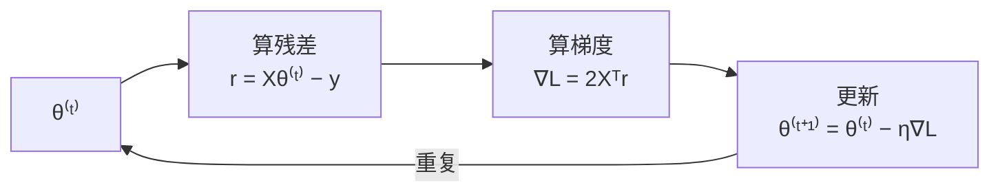

- 两个参数 $(b,a)$ **同时**更新：先用**旧**参数算残差，再一起更新，然后才开始下一轮。
- 线性回归里 $\nabla\mathcal L=\begin{pmatrix}2\sum r_i\\2\sum x_ir_i\end{pmatrix}$（就是 3.3 里的两个偏导）。

### 4.4 ✏️ 手算 2 步（$\eta=0.04$，从 $(b,a)=(0,0)$ 出发，Slides P.35–40）

**第 0 步（起点）：** 预测全是 0，所以 $r_i=0-y_i=-y_i$。
- $\sum r_i=-10$，$\sum x_ir_i=-\sum x_iy_i=-20$。
- 梯度 $=2\binom{-10}{-20}=\binom{-20}{-40}$。
- 损失 $=\sum y_i^2=2.25+0.25+1+6.25+56.25=66$。

**第 1 步：** $\theta^{(1)}=\binom00-0.04\binom{-20}{-40}=\binom{0.8}{1.6}$。新直线 $y=0.8+1.6x$，损失 **14.8**。

**第 2 步（先自己算，再对答案）：**
- 预测 $0.8+1.6x_i=(-2.4,\,-0.8,\,0.8,\,2.4,\,4.0)$；
- 残差（预测−目标）$=(-0.9,\,-1.3,\,-0.2,\,-0.1,\,-3.5)$，$\sum r_i=-6$；
- $\sum x_ir_i=(-2)(-0.9)+(-1)(-1.3)+0\cdot(-0.2)+1\cdot(-0.1)+2\cdot(-3.5)=1.8+1.3+0-0.1-7=-4$；
- 梯度 $=2\binom{-6}{-4}=\binom{-12}{-8}$，所以 $\theta^{(2)}=\binom{0.8}{1.6}-0.04\binom{-12}{-8}=\binom{1.28}{1.92}$，损失 8.656 ✓。

完整轨迹（本库复算）：

| 步 $t$ | $b$ | $a$ | 损失 |
|---|---|---|---|
| 0 | 0 | 0 | 66 |
| 1 | 0.8 | 1.6 | 14.8 |
| 2 | 1.28 | 1.92 | 8.656 |
| 3 | 1.568 | 1.984 | 6.936 |
| 5 | 1.84448 | 1.99936 | 6.121 |
| 解析解 | 2 | 2 | 6 |

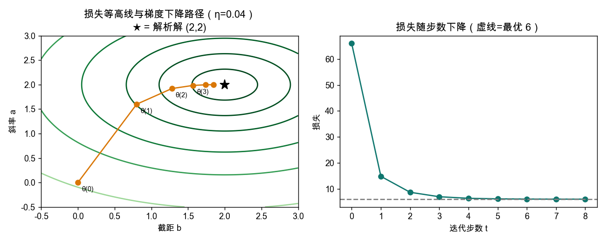

*图 5：左：参数平面 $(b,a)$ 上的损失等高线（越靠中心损失越小）与梯度下降路径，终点是解析解 ★(2,2)。右：损失随步数迅速下降并趋于 6。*

怎么看左图：每个椭圆是"损失相同"的点连成的圈；梯度垂直于等高线，所以路径一开始斜着冲、后面向中心弯。等高线是椭圆而非正圆，所以路径不是笔直走向中心。

### 4.5 学习率 $\eta$ 的坑

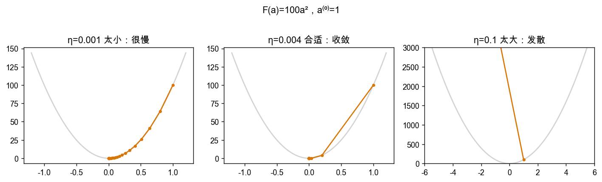

*图 6：用讲义的例子 $F(a)=100a^2$（梯度 $200a$），从 $a^{(0)}=1$ 出发。更新 $a\leftarrow(1-200\eta)a$。*

| $\eta$ | 每步乘以 | 结果 |
|---|---|---|
| 0.001 | 0.8 | 收敛，但很慢 |
| 0.004 | 0.2 | 收敛，很快 |
| 0.1 | **−19** | 每步放大 19 倍并翻符号，**发散** |

（讲义例子就是 $\eta=0.1$：$a^{(t+1)}=-19a^{(t)}$：1 → −19 → 361 → −6859 …）

> [!TIP]
> **经验**
> $\eta$ 要"小到够用"：太小慢，太大炸。以后训练神经网络，调学习率是日常操作。

### 4.6 闭式解 vs 梯度下降

| | 正规方程（闭式解） | 梯度下降 |
|---|---|---|
| 做法 | 解 $X^\top X\theta=X^\top y$ | 迭代更新 |
| 代价（$p$=参数个数） | 约 $O(Np^2+p^3)$ | 每步约 $O(Np)$ |
| 能否用于神经网络 | **不能**（没有闭式解） | **能**，是唯一选择 |
| 要不要调 $\eta$ | 不用 | 要 |

---

## 5. 推广：非线性特征 + 多输入 + 矩阵写法

### 5.1 "线性模型"到底线性在哪

想让线能弯，就把 $x$ 变成一组**特征**：$\phi(x)=(1,x,x^2)$，预测
$$f_\theta(x)=b+w_1x+w_2x^2=\phi(x)\,\theta.$$
关键洞察：这个函数对 $x$ 是弯的，**但对参数 $\theta=(b,w_1,w_2)$ 仍是线性的**（参数只乘一次、只相加）。所以前面的方法**原样适用**，只是把设计矩阵换成特征矩阵 $\Phi$。

> [!WARNING]
> **反例**
> $f(x)=\sin(wx)$ 对 $w$ **不是**线性的，不能写成 $\phi(x)\theta$，不属于这个框架。判断标准永远是：**对参数线性吗？**

✏️ **本讲例子：** 对 5 个点用 $\phi(x)=(1,x,x^2)$，最优 $\theta^*=(1,\,2,\,0.5)$，即 $y=1+2x+0.5x^2$，SSE 从 6 降到 **2.5**（图 3 最右）。验证见 5.4。

### 5.2 设计矩阵（design matrix）

多个输入时，$\mathbf x_i=(x_{i1},\dots,x_{id})$ 是一行。预测 $f_\theta(\mathbf x_i)=b+\sum_j x_{ij}w_j$。

**技巧：** 在每个观测前面补一个 1，把截距 $b$ 也收进参数向量：
$$X=\begin{pmatrix}1&\mathbf x_1\\\vdots&\vdots\\1&\mathbf x_N\end{pmatrix}\in\mathbb R^{N\times(d+1)},\qquad \theta=\begin{pmatrix}b\\w_1\\\vdots\\w_d\end{pmatrix}\in\mathbb R^{(d+1)\times1}.$$
每行是一个观测，每列是一个特征（第一列全 1）。这样**所有预测一次算完**：$\hat{\mathbf y}=X\theta$，残差 $\mathbf r=X\theta-\mathbf y$，损失 $\mathcal L=\|X\theta-\mathbf y\|_2^2$。

**形状检查（用 0.4 的"中间维度消掉"法）：**

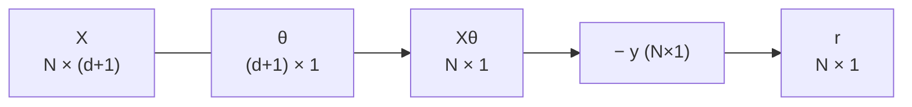

本讲 5 个点、一个输入：$N=5,\ d=1$，$X$ 是 $5\times2$：
$$X=\begin{pmatrix}1&-2\\1&-1\\1&0\\1&1\\1&2\end{pmatrix},\quad\mathbf y=\begin{pmatrix}-1.5\\0.5\\1\\2.5\\7.5\end{pmatrix}.$$

### 5.3 正规方程（normal equations）

对 $\theta_j$ 求导，用 $\partial r_i/\partial\theta_j=X_{ij}$：$\frac{\partial\mathcal L}{\partial\theta_j}=2\sum_iX_{ij}r_i=2(X^\top\mathbf r)_j$。合起来：
$$\nabla\mathcal L(\theta)=2X^\top(X\theta-\mathbf y).$$
令其为 0，得
$$\boxed{X^\top X\,\theta=X^\top\mathbf y}\ \Longrightarrow\ \boxed{\theta^*=(X^\top X)^{-1}X^\top\mathbf y}.$$

（3.3 里那两个标量方程就是它的 $d=1$ 特例。）

> [!WARNING]
> **形状别弄混（考点）**
> - $X^\top X$：$(d+1)\times(d+1)$，**正规方程里要用的**。
> - $XX^\top$：$N\times N$，**不是**这里的东西，两者不能互换。
> - $X^\top X$ 可逆的条件：$X$ 的列线性无关（$N\ge d+1$ 且特征间没有完全共线）。讲义附录 A 的证明思路：若 $X^\top Xv=0$，则 $\|Xv\|^2=v^\top X^\top Xv=0$，所以 $Xv=0$，列线性无关就迫使 $v=0$。

### 5.4 ✏️ 用矩阵重算两次（核对结果）

**(a) 直线：**
$$X^\top X=\begin{pmatrix}N&\sum x\\\sum x&\sum x^2\end{pmatrix}=\begin{pmatrix}5&0\\0&10\end{pmatrix},\qquad X^\top\mathbf y=\begin{pmatrix}\sum y\\\sum xy\end{pmatrix}=\begin{pmatrix}10\\20\end{pmatrix}.$$
$5b=10,\ 10a=20\Rightarrow(b,a)=(2,2)$ ✓。

**(b) 二次特征：** $\Phi$ 的三列是 $1,\,x,\,x^2$。
$$\Phi^\top\Phi=\begin{pmatrix}5&0&10\\0&10&0\\10&0&34\end{pmatrix},\quad\Phi^\top\mathbf y=\begin{pmatrix}10\\20\\27\end{pmatrix}.$$
（$\sum x^4=16+1+0+1+16=34$；$\sum x^2y=4(-1.5)+0.5+0+2.5+4(7.5)=27$。）
中间行：$10w_1=20\Rightarrow w_1=2$。第一行：$5b+10w_2=10\Rightarrow b=2-2w_2$。第三行：$10b+34w_2=27\Rightarrow20-20w_2+34w_2=27\Rightarrow w_2=0.5$，$b=1$。
结果 $(b,w_1,w_2)=(1,2,0.5)$ ✓。

### 5.5 全部公式压缩成一张表

| | 标量直线 | 一般（多输入 / 特征） |
|---|---|---|
| 预测 | $b+ax$ | $X\theta$（$X$ 或 $\Phi$） |
| 损失 | $\sum(b+ax_i-y_i)^2$ | $\|X\theta-\mathbf y\|^2$ |
| 梯度 | $2\binom{\sum r_i}{\sum x_ir_i}$ | $2X^\top(X\theta-\mathbf y)$ |
| 闭式解 | $a^*,b^*$ 公式 | $(X^\top X)^{-1}X^\top\mathbf y$ |
| 梯度下降 | $b\!-\!=\!2\eta\sum r_i,\ a\!-\!=\!2\eta\sum x_ir_i$ | $\theta\!-\!=\!2\eta X^\top(X\theta-\mathbf y)$ |

---

## 6. Lab：PyTorch 要点（对应 Week 2 Lab）

Lab 做三个 notebook（顺序：intro_to_pytorch → python_classes_part2 → gpus_with_pytorch）。完整讲解见 [FOAI-W02-PyTorch入门](FOAI-公开版-W02-PyTorch入门.md)，这里只列和回归直接相关的部分。

| Lab 概念 | 在回归里的用处 |
|---|---|
| `tensor`、shape | 数据 $X$（$N\times(d+1)$）、$\mathbf y$、$\theta$ 都是 tensor |
| `A @ B` 矩阵乘法（`*` 是逐元素乘，别混） | `X @ theta` 就是 $X\theta$ |
| `A.T` / 转置 | `X.T @ r` 就是 $X^\top\mathbf r$ |
| `sum / mean`，`keepdim=True` | 算 $\sum r_i$、$\bar y$；保持维度方便广播 |
| **broadcasting**（从右往左对齐，维度相等或为 1） | 如 $(N,1)$ 与 $(N,)$ 相减会意外变成 $(N,N)$，是常见踩坑 |
| `__call__`（让对象像函数被调用） | `model(x)`，后面的 `nn.Module` 就是这么用的 |
| 在 GPU 上直接创建 tensor | 大矩阵时更快，见 Notebook 3 |

> [!WARNING]
> **回归里的 shape 坑**
> $\mathbf y$ 如果是 shape `(N,)` 而 $X\theta$ 是 `(N,1)`，相减会触发 broadcasting 变成 `(N,N)`，损失悄悄算错且不报错。写代码时先 `print(x.shape)` 对一遍。

下一步：[FOAI-W03-PyTorch线性回归实验](FOAI-公开版-W03-PyTorch线性回归实验.md)——用 PyTorch 把本讲的正规方程和梯度下降各写一遍，结果应当对上第 4、5 节的数字。

---

## 7. 和 Week 3（线性分类）的衔接

本讲的三步套路在 Week 3 里**只换其中几步**：

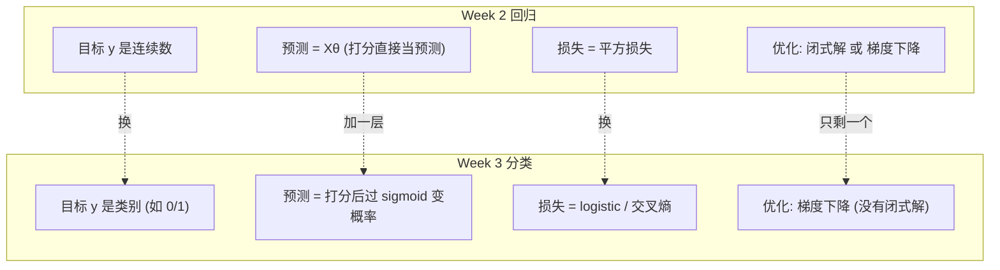

所以 **梯度下降和设计矩阵这两块要真正吃透**，Week 3 会直接用。接着读 [FOAI-W03-线性分类](FOAI-公开版-W03-线性分类.md)。

---

## 8. 常见误区速查

| 误区 | 正解 |
|---|---|
| 残差 = 目标 − 预测 | 本课统一为 **预测 − 目标** |
| $(\sum x)^2=\sum x^2$ | 不等。例中分别为 0 和 10 |
| $f$ 的 SSE 最小 ⇒ 它是最佳直线 | 只是候选里最好，要靠求导算出真正最优 |
| 平方损失、绝对损失最优常数一样 | 均值 vs 中位数 |
| $1+2x+0.5x^2$ 不是线性模型 | 对**参数**线性，所以是 |
| 正规方程里是 $XX^\top$ | 是 $X^\top X$ |
| 学习率越大收敛越快 | 太大发散（$\eta=0.1$ 例中每步 ×(−19)） |
| 训练损失更小就更好 | 可能过拟合；泛化后面讲 |

---

## 9. 自测（先盖住答案自己做）

1. 写出残差的定义。$\ell_{\text{sq}}$ 和 $\ell_{\text{abs}}$ 在误差翻倍时分别变几倍？
2. 对常数预测 $f(x)=b$，推导 $\mathcal L'(b)$，求出 $b^*$。为什么它是全局最小？
3. 用 5 个数据点算：$\sum x,\ \sum y,\ \sum x^2,\ \sum xy$，并求最优直线。
4. 为什么拟合线一定过 $(\bar x,\bar y)$？
5. 梯度下降为什么沿负梯度走？$\eta$ 太大会怎样？
6. 为什么 $f(x)=1+2x+0.5x^2$ 仍叫线性回归？$\sin(wx)$ 为什么不是？
7. $X$ 的形状是什么？$X^\top X$ 和 $XX^\top$ 的形状各是什么，哪个出现在正规方程里？
8. 讲义习题（见 [习题要点](FOAI-公开版-W02-线性回归.md)）：Ex 1–5 自己做一遍，再对照课程仓库 `Week_02` 里的官方解答。

参考答案（做完再看）

1. $r=f(x_i)-y_i$（预测−目标）；绝对损失 ×2，平方损失 ×4。
2. $\mathcal L'(b)=2(Nb-\sum y_i)$，$b^*=\bar y$；$\mathcal L$ 是开口向上的抛物线，唯一驻点即最低点。
3. $\sum x=0,\ \sum y=10,\ \sum x^2=10,\ \sum xy=20$；$a^*=2,\ b^*=2$，直线 $y=2+2x$，SSE=6。
4. 由 $b^*=\bar y-a^*\bar x$，得 $f(\bar x)=b^*+a^*\bar x=\bar y$。
5. 一阶近似 $\mathcal L(\theta+\Delta)\approx\mathcal L-\eta\|\nabla\mathcal L\|^2$，是减去非负数；$\eta$ 太大一阶近似失效，会发散。
6. 对参数 $(b,w_1,w_2)$ 线性；$\sin(wx)$ 对 $w$ 非线性。
7. $N\times(d+1)$；$X^\top X$ 是 $(d+1)\times(d+1)$，$XX^\top$ 是 $N\times N$；前者出现在正规方程。

